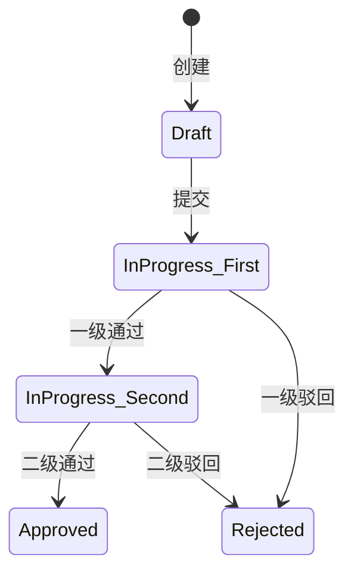

# 01 — 项目需求与范围定义（Project Spec）

| 属性 | 内容 |
|---|---|
| 文档编号 | SPEC-001 |
| 版本 | V0.3 |
| 状态 | 初稿，基于任务书整理 |
| 需求来源 |《简易审批流系统—实习生开发任务书》 |

## 1. 项目背景与目标

开发一套简易审批流系统，支持员工提交申请、审批人处理申请、申请人查看进度和审批历史。本期实现固定两级串行审批，提供浏览器可操作的前端、后端 API 和关系型数据库。

项目目标包括：需求分析、数据库设计、前端页面、API 开发、身份认证、权限校验、状态流转、事务一致性、测试及 Git 交付。

## 2. 范围

### 2.1 本期范围（必须实现）

- 用户注册、登录、当前用户信息查询。
- JWT Bearer 身份认证。
- 创建、编辑、删除申请草稿。
- 提交申请。
- 固定两级串行审批。
- 一级或二级审批通过、驳回。
- 申请详情、我发起的申请、待我审批列表。
- 分页、状态筛选、标题关键词搜索。
- 审批历史查询。
- 后端权限校验、统一异常处理和参数校验。
- 数据库事务、重复审批防护和并发控制。
- Vue 浏览器页面、Swagger / OpenAPI。
- 自动化测试、README、数据库迁移和 Docker Compose。

### 2.2 本期不实现

驳回后修改重提、申请撤回、会签、转交、加签、动态修改审批人、通用流程设计器、消息通知、附件上传、移动端适配、微服务架构。

## 3. 用户与业务身份

系统不设置独立管理员角色。所有注册用户均可创建申请。

同一用户可在不同申请中承担不同身份：
- 申请人：创建并提交申请。
- 一级审批人：处理第一个审批节点。
- 二级审批人：处理第二个审批节点。

申请人不得审批自己提交的申请。一级和二级审批人可以是同一用户，但必须分别完成两个步骤。

## 4. 申请单字段与规则

| 字段 | 规则 |
|---|---|
| Id | 唯一标识 |
| Title | 必填，最长 100 字符 |
| Content | 必填，最长 2000 字符 |
| Status | Draft / InProgress / Approved / Rejected |
| ApplicantId | 由当前登录用户确定 |
| FirstApproverId | 必须是已存在用户 |
| SecondApproverId | 必须是已存在用户 |
| CurrentStep | First / Second / NULL |
| CreatedAt | 创建时间 |
| UpdatedAt | 最近更新时间 |
| SubmittedAt | 最近一次提交时间，可为空 |

创建申请时状态为 Draft。仅申请人可以编辑或删除自己的草稿。审批中和已结束的申请不可删除或编辑。

申请人不能将自己指定为任一级审批人。

## 5. 审批状态机

合法状态与步骤组合：

| Status | CurrentStep | 含义 |
|---|---|---|
| Draft | NULL | 草稿 |
| InProgress | First | 等待一级审批 |
| InProgress | Second | 等待二级审批 |
| Approved | NULL | 审批通过，流程结束 |
| Rejected | NULL | 审批驳回，流程结束 |

其他组合均不合法。

规则：
1. 只有 Draft 可以提交。
2. 提交后进入 InProgress / First。
3. 一级通过后进入 InProgress / Second。
4. 二级通过后进入 Approved / NULL。
5. 任一节点驳回后进入 Rejected / NULL。
6. 通过意见允许为空；驳回意见必填，最长 500 字符。
7. 不允许跳过节点、重复审批或审批已结束申请。
8. 本期不支持驳回后重新提交。

## 6. 权限规则

| 操作 | 申请人 | 当前审批人 | 其他用户 |
|---|---|---|---|
| 创建申请 | 允许 | 允许 | 允许 |
| 查看申请 | 自己的申请 | 自己参与的申请 | 禁止 |
| 编辑草稿 | 允许 | 禁止 | 禁止 |
| 提交草稿 | 允许 | 禁止 | 禁止 |
| 删除草稿 | 允许 | 禁止 | 禁止 |
| 审批 | 禁止 | 仅当前节点审批人允许 | 禁止 |
| 查看历史 | 自己的申请 | 自己参与的申请 | 禁止 |

所有业务接口必须登录。前端可以隐藏无权操作，但最终权限必须由后端校验。

## 7. 审批历史

每次成功提交或审批必须写入历史，至少包含：
- 申请单 ID
- 操作类型
- 操作人 ID
- 审批步骤（提交时可为空）
- 操作意见
- 操作前状态和步骤
- 操作后状态和步骤
- 操作时间

历史按操作时间升序返回；同一时间使用稳定的次级排序键。历史对普通业务用户只读。删除草稿不产生审批历史。

## 8. 事务与并发要求

提交申请或执行审批时，申请单状态 / 当前步骤更新与历史写入必须在同一个数据库事务中完成。两者要么同时成功，要么同时失败。

同一审批步骤成功处理后，旧请求必须被拒绝，不能新增重复历史。并发请求最多一个成功。后端必须根据数据库中的当前状态、当前步骤和当前审批人判断操作是否有效，不能信任前端提交的步骤。

具体实现见 [系统架构设计](02-System-Architecture.md) 和 [数据库设计](03-Database-Design.md)。

## 9. 异常及 HTTP 语义

| 场景 | HTTP 状态 |
|---|---|
| 未登录或 Token 无效 | 401 |
| 无权查看或操作 | 403 |
| 资源不存在 | 404 |
| 参数不合法 | 400（FastAPI 原生校验错误是否统一映射，见 API 文档） |
| 状态冲突、重复审批、并发冲突 | 409 |
| 未预期服务器错误 | 500 |

错误响应不得暴露内部堆栈、密钥或敏感数据。

## 10. 前端页面

必须提供：
- 注册页、登录页。
- 我发起的申请列表。
- 新建 / 编辑申请。
- 申请详情。
- 待我审批列表。
- 审批操作。
- 审批历史。
- 加载状态、空数据提示、成功 / 失败反馈、表单校验和退出登录。

所有核心业务必须能通过浏览器完成，不能只依赖 Swagger 或 Postman。

## 11. 验收条件

至少验证：
1. 创建申请后为草稿，只有申请人可编辑和提交。
2. 草稿不出现在待审批列表。
3. 非当前审批人不能审批。
4. 一级通过后进入二级审批。
5. 二级通过后流程结束。
6. 一级或二级驳回后流程结束，驳回意见不能为空。
7. 历史写入失败时状态更新回滚。
8. 重复及并发审批最多一个请求成功，且不产生重复历史。
9. 申请人不能选择自己作为审批人。
10. 无关用户不能查看详情和历史；未登录请求被拒绝。
11. 分页总数正确，待审批列表只包含当前节点指派给当前用户的申请。
12. 浏览器可完成注册、登录、创建、提交、两级审批和历史查看。
13. 前端正确处理错误、加载和空列表。

其中非当前审批人审批、一级通过推进二级、事务回滚、重复及并发审批必须提供自动化测试。

## 12. 假设与待确认事项

- MySQL 的具体小版本、JWT 有效期、Token 前端存储策略、UI 组件和最终错误响应格式需在实现前确认。
- 申请详情对无关用户返回 403；若改用 404 防止资源枚举，必须在 API 文档中统一说明。
- 本文档只定义业务要求，不规定未确认的实现细节。

## 13. 文档维护

本文件是业务需求、范围、权限、状态规则和验收条件的唯一主要维护位置。技术实现细节分别维护在系统架构、数据库和 API 文档中。
