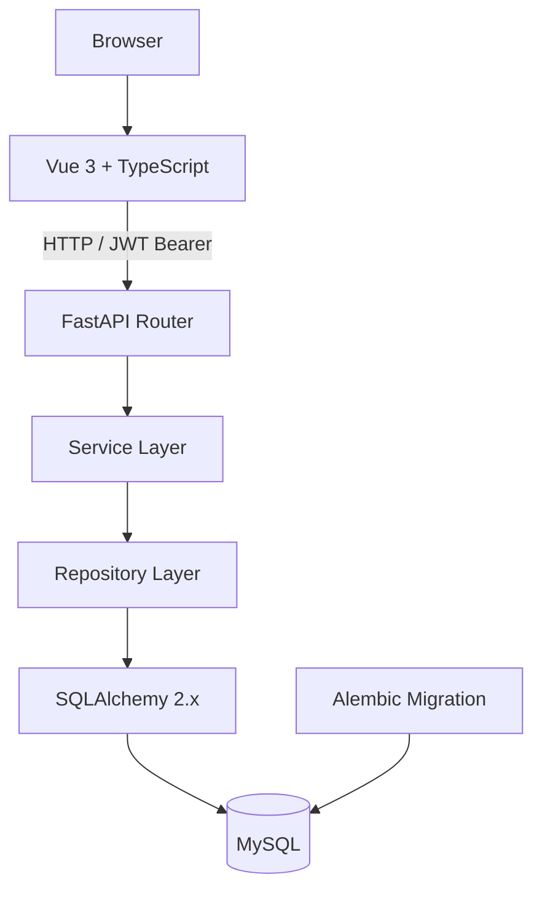

# 02 — 系统架构设计（System Architecture）

| 属性 | 内容 |
|---|---|
| 文档编号 | ARCH-002 |
| 版本 | V0.3 |
| 状态 | 初始技术基线 |

## 1. 已确认技术决策

| 模块 | 方案 | 状态 |
|---|---|---|
| 前端 | Vue 3 + TypeScript | 已确定 |
| 后端 | Python 3.12 + FastAPI | 已确定 |
| Python 依赖管理 | uv | 已确定 |
| ORM | SQLAlchemy 2.x | 已确定 |
| 数据访问 | 同步 Session | 已确定 |
| 数据库 | MySQL | 已确定 |
| 数据库迁移 | Alembic | 已确定 |
| 容器编排 | Docker Compose，开发和验收均使用 | 已确定 |

以下为建议方案，不能与已确认决策混淆：Vite、Vue Router、Pinia、Axios、Element Plus、PyMySQL、Argon2、HS256、MySQL 8.4 LTS。具体版本和安全参数应在工程初始化前确认并锁定。

## 2. 总体架构



前端只通过 HTTP API 访问后端，不得直接连接数据库。

## 3. 模块职责

### 3.1 前端
负责页面展示、表单校验、路由、用户交互和 API 调用。前端权限控制仅用于交互体验，不能代替后端授权。

### 3.2 API 层
负责 HTTP 请求接收、Pydantic 参数校验、身份认证依赖、调用 Service 和组织响应。不得在 Router 中堆积审批业务逻辑。

### 3.3 Service 层
负责业务规则、权限判断、状态流转、事务边界及并发控制。审批操作的事务由 Service 层明确开启和提交。

### 3.4 Repository 层
负责 SQLAlchemy 查询和持久化，不负责 HTTP 状态码或业务流程决策。Repository 不应擅自提交业务事务。

### 3.5 Model / Schema
Model 描述数据库映射；Schema 描述 API 输入输出。两者不能混用。

## 4. 后端目录建议

```text
backend/
├── src/app/
│   ├── api/
│   │   ├── deps.py
│   │   └── v1/
│   │       ├── auth.py
│   │       ├── users.py
│   │       └── requests.py
│   ├── core/
│   │   ├── config.py
│   │   ├── security.py
│   │   ├── exceptions.py
│   │   └── logging.py
│   ├── db/
│   │   ├── base.py
│   │   └── session.py
│   ├── models/
│   ├── schemas/
│   ├── repositories/
│   ├── services/
│   └── main.py
├── migrations/
├── tests/
├── alembic.ini
├── pyproject.toml
└── uv.lock
```

## 5. 身份认证与授权

- 使用 JWT Bearer 认证业务 API。
- 当前用户 ID 从经过验证的 Token 中取得。
- 不信任客户端提交的 applicant_id、operator_id 或 current_step。
- Service 层根据数据库中的申请人、审批人、状态和步骤判断权限。
- 密码使用安全哈希算法保存，不保存明文。
- Token、密码和密钥不得写入日志。

JWT 算法、有效期、密钥配置和 Token 存储策略属于安全配置，实施前需在配置规范中明确。

## 6. 事务边界

提交、通过和驳回均为一个完整事务：
1. 获取申请数据并读取当前状态、步骤和版本。
2. 验证当前用户和业务前置条件。
3. 执行带状态、步骤、审批人及版本条件的更新。
4. 检查更新影响行数。
5. 新增审批历史。
6. 提交事务。

任意一步失败必须回滚。状态更新和历史写入不能分成两个独立提交。

不应在事务中执行外部 HTTP 请求或其他不必要的慢操作。

## 7. 并发控制策略

申请表增加 `version` 整数列，初始值为 1。

审批更新使用条件 UPDATE，WHERE 条件至少包含：
- 申请单 ID
- 读取时的 version
- 预期 status
- 预期 current_step
- 当前节点指定审批人 ID

更新时 `version = version + 1`。只有影响行数为 1 才能新增审批历史；影响行数为 0 表示数据已变化或前置条件不成立，返回 409。

SQLAlchemy `version_id_col` 可用于 ORM 普通对象更新的版本检查，但显式批量 UPDATE 不会自动套用该机制。因此审批关键路径必须显式编写版本条件并检查 rowcount。

权限错误和状态冲突需区分：非当前审批人返回 403；有权限用户使用过期状态操作返回 409。实现时应避免通过不安全的更新语句泄露或绕过权限判断。

## 8. Session 管理

- 使用 SQLAlchemy 2.x 同步 Session。
- 每个 HTTP 请求创建独立 Session。
- 请求结束后关闭 Session。
- Session 不跨请求共享。
- FastAPI 依赖负责 Session 生命周期，不自动提交业务事务。
- Service 层负责事务提交和回滚。

建议的初始连接池参数应根据容器资源和测试结果调整，不将示例参数视为容量承诺。

## 9. 数据库迁移

Alembic 是数据库结构版本管理的唯一正式方式：
- Model 变更后生成并检查迁移文件。
- 检查自动生成的索引、外键和 CHECK 约束。
- 迁移文件纳入 Git。
- 不以 `Base.metadata.create_all()` 代替正式迁移。
- 容器启动时由一次性 migration 服务执行 `alembic upgrade head`。

## 10. 关键技术决策（ADR）

### ADR-001：同步 SQLAlchemy Session
状态：Accepted。理由：项目规模和周期有限，同步事务更直观，减少异步驱动和调试复杂度。

### ADR-002：Alembic
状态：Accepted。理由：数据库结构版本化、可审查、可重复初始化。

### ADR-003：Docker Compose
状态：Accepted。开发和验收均通过 Compose 管理服务，降低环境差异。

### ADR-004：Version 乐观锁
状态：Accepted。通过数据库条件更新避免旧数据覆盖和同一审批节点重复推进。

### ADR-005：固定两级审批数据模型
状态：Accepted。本期在申请单上直接保存两个审批人，不引入通用流程定义和节点表。若未来扩展动态多级审批，再重新评估数据模型。

## 11. 设计限制

- 乐观锁不自动保证所有业务正确，权限校验、状态条件、事务和历史写入必须共同实现。
- MySQL CHECK 约束需在目标 MySQL 版本中验证实际执行行为。
- 历史“只追加”目前是应用层约束；若需要抵御数据库管理员直接修改，需额外数据库权限或审计机制。
- 具体数据库表字段与索引以 [数据库设计](03-Database-Design.md) 为准。
- 接口契约以 [API 设计](04-API-Design.md) 为准。


## 第一阶段实施决定（2026-11-24）

工程初始化采用 Vite 7、PyMySQL、MySQL 8.4.7，具体依赖见锁文件。源码保留 backend/src/app 布局。前端只有连通状态页，后端只有 /api/health；认证和审批业务仍待实现。其余建议库和安全配置留待对应阶段决定。

## 第二阶段实施决定（2026-11-24）

- 后端认证使用 Argon2id（argon2-cffi）和 PyJWT；JWT 固定 HS256，不从请求或 JWT header 动态选择算法。密钥来自 JWT_SECRET_KEY，至少 32 字节且不可使用示例占位符，启动时检查。JWT_EXPIRE_MINUTES 默认 60，允许 1–1440。
- Token 必须包含 sub/iat/exp/iss/aud/type，验证签名、时间、固定 issuer/audience、access 类型和 UUID 用户 ID，依赖查询用户存在。当前无 refresh/revoke/logout API；前端存储方式尚未实施。
- API → Service → Repository → Session；认证依赖和路由共享单请求 Session，依赖只关闭，写入由 Service 提交/回滚。认证查询已隐式开启事务，Service transaction 上下文接管该事务，不嵌套 begin。
- 草稿编辑使用 id/applicant_id/Draft/version 条件 UPDATE，成功后 version+1；删除使用读取版本及 Draft 条件 DELETE。这里只保护草稿基础生命周期，审批事务/历史/并发路径尚未实现。
- 业务异常、HTTP 异常和 422 使用统一 error.code/message；验证错误不回显输入。最外层 HTTP 用户中间件捕获未预期异常，只记录异常类型，避免框架重新抛出异常导致 Uvicorn 打印 SQL 参数。完整堆栈未写入应用日志。
- 无表结构变化；初始迁移仍为 head。模型、数据库约束保持第一阶段设计。
- 安全实现参考：[PyJWT 验证文档](https://pyjwt.readthedocs.io/en/stable/api.html)、[Argon2 PasswordHasher](https://argon2-cffi.readthedocs.io/en/stable/api.html)。
