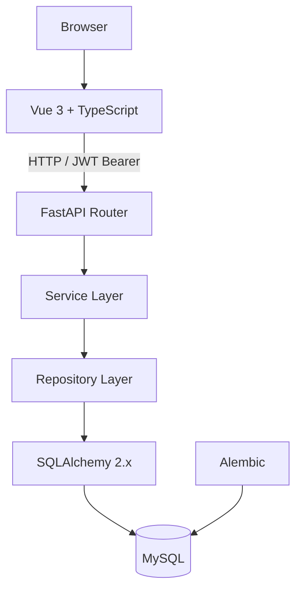

# 02 — 系统架构设计（System Architecture）

| 属性 | 内容 |
|---|---|
| 文档编号 | ARCH-002 |
| 版本 | V1.0 |
| 状态 | 终稿 |

## 1. 技术栈

前端 Vue 3 + TypeScript + Vite + Pinia + Vue Router + Element Plus + Axios；后端 Python 3.12 + FastAPI + uv + SQLAlchemy 2.x（同步 Session）+ PyMySQL；数据库 MySQL 8.4.7 + Alembic；认证 JWT（HS256）+ Argon2id；容器 Docker Compose。

## 2. 总体架构

前端只通过 HTTP API 访问后端，不得直连数据库。

## 3. 模块职责

- **前端**：页面、表单校验、路由、API 调用。前端权限控制仅用于交互，不替代后端授权。
- **API 层**（`app/api/`）：HTTP 接收、Pydantic 校验、认证依赖、调用 Service、组织响应，不堆积业务逻辑。
- **Service 层**（`app/services/`）：业务规则、权限判断、状态流转，并明确开启/提交事务。审批关键路径在此实现并发控制。
- **Repository 层**（`app/repositories/`）：查询与持久化，不决定业务、不负责状态码、不擅自提交事务。
- **Model / Schema**：ORM 映射与 API 输入输出分离，不可混用。

依赖方向严格单向：API → Service → Repository → SQLAlchemy → MySQL。

## 4. 认证与授权

- JWT Bearer 认证业务 API；当前用户 ID 从已验证 Token 取得。
- 不信任客户端提交的 `applicant_id`、`operator_id` 或 `current_step`。
- Service 层依据数据库中的申请人、审批人、状态、步骤判断权限。
- 密码用 Argon2id 哈希存储；Token、密码、密钥不写入日志。

JWT 固定 HS256，校验签名、exp、iat、UUID sub、固定 issuer/audience、access 类型，并查询用户仍存在。密钥来自 `JWT_SECRET_KEY`（≥32 字节），默认有效期 60 分钟，可配置 1–1440 分钟。无 refresh/revoke 接口。

## 5. 事务边界

提交、通过、驳回各为一个完整事务：读取状态/步骤/版本 → 校验权限与前置条件 → 带状态/步骤/审批人/版本条件的更新 → 检查影响行数 → 新增历史 → 提交。任一步失败回滚；状态更新与历史写入不得拆成两个提交。事务内不做外部 HTTP 请求。

## 6. 并发控制（乐观锁）

`requests.version` 整数列初始为 1。审批用条件 UPDATE，WHERE 至少含 `id`、读取时 `version`、预期 `status`、预期 `current_step`、当前节点审批人；更新时 `version = version + 1`，仅当 `rowcount == 1` 才写历史，否则回滚并返回 409。

注意 `version_id_col` 只对 ORM 普通对象更新生效，显式批量 UPDATE 不自动套用，审批路径必须显式写版本条件并检查 rowcount。

权限与状态冲突须区分：非当前审批人返回 403；有权限但状态过期/并发返回 409。

## 7. Session 管理

同步 Session，每 HTTP 请求独立创建、结束关闭、不跨请求共享。FastAPI 依赖只管理生命周期；事务由 Service 提交/回滚。

## 8. 数据库迁移

Alembic 是结构版本化的唯一正式方式：Model 变更后生成并人工检查迁移，迁移纳入 Git；不用 `Base.metadata.create_all()` 代替；容器启动由一次性 migrate 服务执行 `alembic upgrade head`。

## 9. 关键决策（ADR）

- **ADR-001 同步 Session**：Accepted。项目规模有限，同步事务直观，降低调试复杂度。
- **ADR-002 Alembic**：Accepted。结构版本化、可审查、可重复初始化。
- **ADR-003 Docker Compose**：Accepted。开发与验收均经 Compose 管理，降低环境差异。
- **ADR-004 Version 乐观锁**：Accepted。条件更新避免旧数据覆盖与同节点重复推进。
- **ADR-005 固定两级审批数据模型**：Accepted。申请单直接保存两个审批人，不引入通用流程表；若未来扩展动态多级审批再评估。
