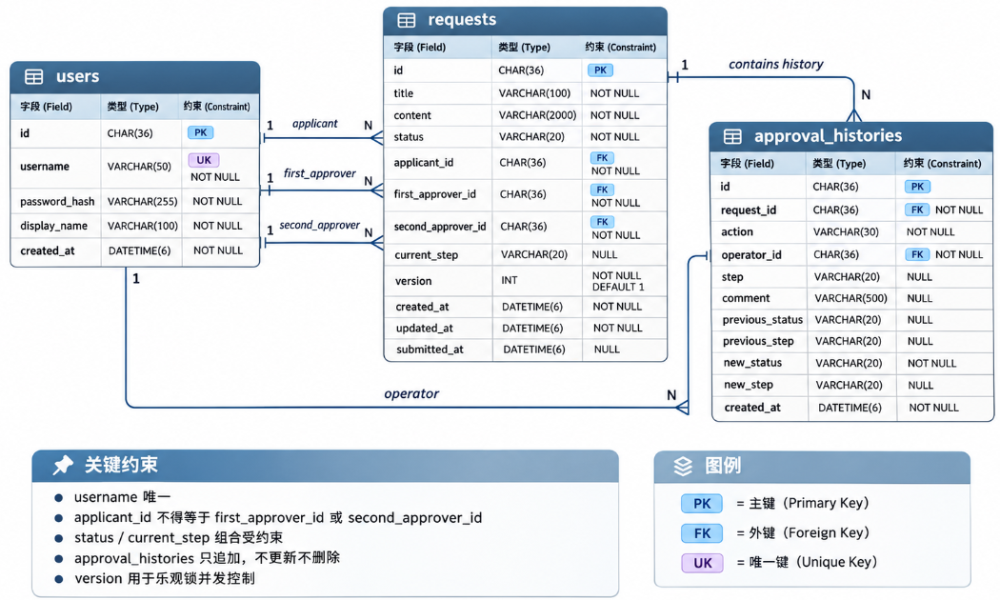

# 03 — 数据库设计（Database Design）

| 属性 | 内容 |
|---|---|
| 文档编号 | DB-003 |
| 版本 | V1.0 |
| 数据库 | MySQL 8.4.7 |
| ORM | SQLAlchemy 2.x，同步 Session |
| 迁移 | Alembic |

## 1. 数据库约定

InnoDB；字符集 utf8mb4（大小写敏感 `utf8mb4_0900_as_cs`，含 username 唯一性）；主键 UUID 用 `CHAR(36)`；时间按 UTC 存储、API 用 ISO 8601；外键删除策略 RESTRICT。

## 2. ER 图

## 3. users 表

| 字段 | 类型 | 约束 |
|---|---|---|
| id | CHAR(36) | PK |
| username | VARCHAR(50) | NOT NULL, UNIQUE |
| password_hash | VARCHAR(255) | NOT NULL |
| display_name | VARCHAR(100) | NOT NULL |
| created_at | DATETIME(6) | NOT NULL |

密码只存 Argon2id 哈希；无普通用户删除账户功能。

## 4. requests 表

| 字段 | 类型 | 约束 |
|---|---|---|
| id | CHAR(36) | PK |
| title | VARCHAR(100) | NOT NULL |
| content | VARCHAR(2000) | NOT NULL |
| status | VARCHAR(20) | NOT NULL |
| applicant_id | CHAR(36) | FK users.id, NOT NULL |
| first_approver_id | CHAR(36) | FK users.id, NOT NULL |
| second_approver_id | CHAR(36) | FK users.id, NOT NULL |
| current_step | VARCHAR(20) | NULL |
| version | INT | NOT NULL, DEFAULT 1 |
| created_at | DATETIME(6) | NOT NULL |
| updated_at | DATETIME(6) | NOT NULL |
| submitted_at | DATETIME(6) | NULL |

约束：`applicant_id` 不得等于任一审批人；审批人必须关联现存用户；`version >= 1`；`(status, current_step)` 组合受 CHECK 约束限制（仅五种合法组合）；申请人/审批人规则同时在 Service 层校验。

## 5. approval_histories 表

| 字段 | 类型 | 约束 |
|---|---|---|
| id | CHAR(36) | PK |
| request_id | CHAR(36) | FK requests.id, NOT NULL |
| action | VARCHAR(30) | NOT NULL |
| operator_id | CHAR(36) | FK users.id, NOT NULL |
| step | VARCHAR(20) | NULL |
| comment | VARCHAR(500) | NULL |
| previous_status | VARCHAR(20) | NULL |
| previous_step | VARCHAR(20) | NULL |
| new_status | VARCHAR(20) | NOT NULL |
| new_step | VARCHAR(20) | NULL |
| created_at | DATETIME(6) | NOT NULL |

`action` 允许 Submit / FirstApprove / FirstReject / SecondApprove / SecondReject。创建与删除草稿不生成历史；每次成功提交/审批在同一事务新增历史；业务 API 只提供历史新增与查询。

## 6. 索引规划

| 表 | 索引 | 用途 |
|---|---|---|
| users | UNIQUE(username) | 登录与唯一性 |
| requests | (applicant_id, created_at, id) | 我发起的列表 |
| requests | (first_approver_id, status, current_step, created_at, id) | 一级待审批 |
| requests | (second_approver_id, status, current_step, created_at, id) | 二级待审批 |
| approval_histories | (request_id, created_at, id) | 历史查询及稳定排序 |

标题关键词用 LIKE 子串匹配，`%`/`_` 不作通配符。索引须用 EXPLAIN 验证。

## 7. 查询规则

- **我发起的**：`applicant_id = 当前用户`，可按 status、title 筛选，分页返回 items/total/page/pageSize。
- **待我审批**：只查 `status = InProgress` 且当前步骤对应审批人 == 当前用户（First 匹配 `first_approver_id`，Second 匹配 `second_approver_id`）。不能只按审批人字段查，否则会误列已过期节点或已结束申请。
- **审批历史**：按 `created_at ASC, id ASC` 稳定排序。

## 8. 事务与并发

提交/通过/驳回在同一事务更新 requests 并新增 approval_histories。审批条件 UPDATE 至少含 id、version、预期 status、预期 current_step、当前步骤审批人；成功后 version+1；rowcount 不为 1 时不写历史并返回 409；历史写入失败回滚状态与 version。

## 9. ORM 实现约定

- 模型继承统一 Declarative Base。
- 微秒精度时间用 `sqlalchemy.dialects.mysql.DATETIME(fsp=6)`，勿把 `fsp` 传给通用 `DateTime`。
- UUID 主键 `CHAR(36)`，应用层 `str(uuid.uuid4())`。
- `Request` 对 users 有三条外键，relationship 须显式指定 `foreign_keys` 避免歧义。
- `version_id_col` 仅对 ORM 普通对象更新生效；审批显式 UPDATE 须自写版本条件并检查 rowcount。

## 10. 迁移

迁移目录 `backend/migrations/`，命令见根目录 README/CLAUDE.md。autogenerate 后须人工检查外键、索引、CHECK 约束、默认值、时间精度。禁止以 `Base.metadata.create_all()` 代替 Alembic。
